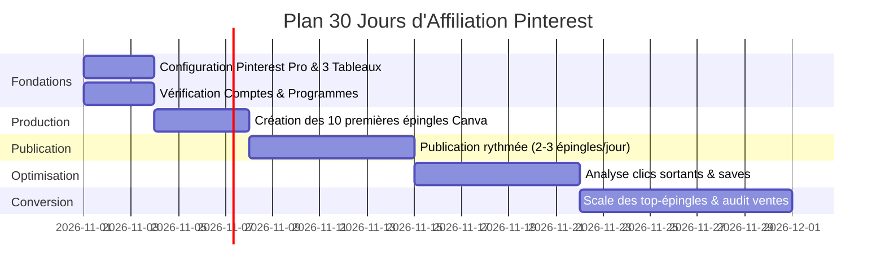

# PLAN OPÉRATIONNEL D'AFFILIATION PINTEREST — HERVÉ NANFANG
**Stratégie 0 FCFA • Niche Home Studio & MAO • Marchés Afrique & International**

---

## 1. VISION STRATÉGIQUE & MODÈLE

### 1.1 Principe clé
Créer un moteur d'acquisition passif et gratuit via Pinterest pour attirer une audience qualifiée avec une **forte intention d'achat** dans l'univers musical, et convertir ce trafic en commissions d'affiliation sans investissement financier initial.

- **Niche Principale** : Home studio accessible (micros USB/XLR, casques de monitoring, claviers maîtres MIDI, interfaces audio, pieds, filtres anti-pop, acoustique d'appoint).
- **Niche Secondaire** : MAO et outils numériques (DAW, banques de sons, plugins VST, synthétiseurs virtuels, formations et masterclasses).
- **Positionnement d'autorité** : Hervé Nanfang, ingénieur du son, compositeur et musicologue. Vos recommandations s'appuient sur une expertise réelle du son, pas sur du dropshipping opportuniste.

---

## 2. PAIEMENTS & PROGRAMMES ÉLIGIBLES DEPUIS LE CAMEROUN (RÉALITÉ DU TERRAIN)

> [!IMPORTANT]
> **Règle d'or** : Ne commencez jamais la promotion d'un lien avant d'avoir validé le circuit complet d'encaissement vers le Cameroun (banque locale, compte Payoneer ou carte bancaire).

| Programme | Pertinence | Seuil | Compatibilité Cameroun | Méthode d'encaissement recommandée |
| :--- | :--- | :--- | :--- | :--- |
| **Amazon Partenaires France** | ⭐⭐⭐⭐ (Très fort pour l'Europe francophone) | 50 € (virement/chèque) / 25 € (carte cadeau) | Possible via compte international ou coordonnées bancaires SEPA / Payoneer | Associer un compte récepteur Payoneer EUR (IBAN européen) vers votre banque camerounaise (UBA, Afriland, etc.) |
| **Thomann Affiliate Program** | ⭐⭐⭐⭐⭐ (#1 matériel musical en Europe) | 50 € | Accessible aux créateurs internationaux | Virement bancaire / SEPA via Payoneer ou virement international |
| **Plugin Boutique / Loopmasters** | ⭐⭐⭐⭐⭐ (N°1 plugins MAO & banques de sons) | 50 $ | Mondial via PayPal ou virement | Virement direct ou Payoneer |
| **Native Instruments Partner** | ⭐⭐⭐⭐ (Matériel pro & Kontakt/Komplete) | Variable | Variable selon réseau affilié (ex. CJ ou Awin) | À vérifier selon le réseau hébergeur |
| **Awin** | ⚠️ Déconseillé au départ | 20 $ | Nécessite un dépôt de garantie initial | Exclu avec un budget de 0 FCFA |

### Les 4 vérifications avant diffusion de liens :
1. Le pays de résidence fiscale accepté est-il bien le **Cameroun** ?
2. Le versement par **IBAN européen virtuel (via Payoneer)** ou **virement SWIFT** est-il disponible ?
3. Le programme autorise-t-il explicitement le partage sur **Pinterest** et les réseaux sociaux ?
4. La mention légale d'affiliation (*« Lien affilié : commission potentielle sans surcoût pour vous »*) est-elle bien affichée ?

---

## 3. FEUILLE DE ROUTE OPÉRATIONNELLE SUR 30 JOURS (0 FCFA)



### J1 à J3 : Fondations
- Convertir le compte en **Pinterest Business**.
- Renseigner la bio officielle, photo professionnelle et lien canonique vers `https://hervenanfang.vercel.app`.
- Créer les 3 tableaux thématiques :
  1. *Home Studio pour débutants* (Microphones, casques, cartes son).
  2. *MAO & Logiciels de musique* (Plugins, DAW, banques de sons, mixage).
  3. *Équipement du musicien live* (Claviers de scène, accessoires voix, câblage).

### J4 à J7 : Production graphique
- Format recommandé Pinterest : **1 000 × 1 500 px** (ratio 2:3 vertical).
- Utiliser le forfait gratuit de **Canva**.
- Appliquer l'identité visuelle de marque : typographies élégantes, contrastes forts, fonds sombres ou clairs minimalistes, badges de réassurance (*« Guide 2026 »*, *« Test d'ingénieur »*).

### J8 à J14 : Rythme de publication
- Publier 2 à 3 épingles par jour aux heures de forte consultation (18h-22h CET / WAT).
- Écrire des descriptions riches en mots-clés d'intention d'achat (français et anglais).
- Mention de transparence obligatoire : `#affiliate` ou mention dans le texte.

### J15 à J21 : Optimisation par la donnée
- Surveiller sur Pinterest Analytics :
  - Impressions (portée de l'algorithme)
  - Épingles enregistrées (signe d'un intérêt fort pour plus tard)
  - Clics sortants (le seul indicateur qui amène du revenu).

### J22 à J30 : Scaling et rentabilisation
- Identifier les 2 à 3 sujets qui génèrent le plus de clics sortants.
- Créer 3 variantes visuelles de chaque sujet gagnant (angles différents : problème/solution, comparatif direct, erreurs fréquentes).
- Calculer le ratio clics/commissions effectives.

---

## 4. ARCHITECTURE RECOMMANDÉE : LA STRATÉGIE DE LA "PASSERELLE ÉDITORIALE"

> [!TIP]
> **Pourquoi ne pas mettre de lien affilié direct sur chaque épingle Pinterest ?**
> 1. Les algorithmes de Pinterest pénalisent parfois les liens d'affiliation directs considérés comme agressifs.
> 2. Amazon Partenaires exige un site web actif avec au moins 10 articles originaux avant de valider définitivement le compte.
> 3. En renvoyant l'épingle vers un article comparatif ou une page guide de votre site `hervenanfang.vercel.app` (ex. [Guide Microphones](https://hervenanfang.vercel.app/journal)) :
>    - Vous gagnez du trafic SEO durable sur votre site.
>    - L'acheteur découvre votre profil d'ingénieur du son et vous fait confiance.
>    - Vous placez plusieurs liens affiliés alternatifs sur la même page.

---

## 5. LES 10 PREMIÈRES ÉPINGLES : TITRES, DESCRIPTIONS & MOTS-CLÉS

### Épingle 1 (Achat direct)
- **Titre** : Quel microphone choisir pour débuter en home studio ? Guide USB vs XLR
- **Description** : Vous voulez enregistrer votre voix avec une clarté professionnelle sans dépenser une fortune ? Découvrez notre comparatif d'ingénieur du son : faut-il choisir un micro USB plug & play ou un XLR avec carte son ? Analyse des meilleurs modèles pour débuter. (Lien affilié transparent).
- **Mots-clés** : `micro home studio debutant`, `micro usb vs xlr`, `quel micro pour chanter`, `home studio petit budget`.
- **Destination recommandée** : Article guide sur `hervenanfang.vercel.app/journal` ou lien produit Amazon/Thomann.

### Épingle 2 (Accessoires indispensables)
- **Titre** : 5 accessoires indispensables pour enregistrer une voix nette à la maison
- **Description** : Un bon micro ne suffit pas sans les bons accessoires. Filtre anti-pop, suspension araignée, pied perche robuste, écran acoustique nomade : découvrez la checklist studio pour éliminer les résonances et les bruits parasites.
- **Mots-clés** : `filtre anti pop voix`, `accessoires home studio`, `acoustique chambre musique`.

### Épingle 3 (Comparatif)
- **Titre** : Casque de studio fermé ou ouvert : quel modèle choisir pour votre musique ?
- **Description** : Prise de voix ou mixage ? Choisir entre un casque fermé isolant et un casque ouvert d'une grande précision spectrale change tout à votre rendu sonore. Guide des références testées et approuvées par des pros.
- **Mots-clés** : `casque monitoring studio`, `casque ouvert vs ferme`, `meilleur casque mao`.

### Épingle 4 (Guide technique)
- **Titre** : Interface audio : à quoi sert-elle vraiment et quel modèle acheter ?
- **Description** : Pourquoi votre carte son intégrée ne suffit pas pour faire de la musique ? Préamplificateurs, latence, convertisseurs 24-bit/192kHz : tout comprendre en 2 minutes pour faire le bon choix dès le départ.
- **Mots-clés** : `carte son externe musique`, `interface audio debutant`, `focusrite presonus comparatif`.

### Épingle 5 (Comparatif claviers)
- **Titre** : Clavier maître MIDI ou clavier arrangeur : quelle différence pour composer ?
- **Description** : Vous hésitez entre un contrôleur USB pour vos plugins et un arrangeur autonome avec haut-parleurs ? Ce comparatif complet vous évite de regretter votre achat selon que vous jouez en live ou composez sur ordinateur.
- **Mots-clés** : `clavier midi debutant`, `clavier arrangeur mao`, `piano usb pour composer`.

### Épingle 6 (Budget optimisé)
- **Titre** : Monter un home studio complet pour moins de 300 € : la configuration idéale
- **Description** : Rien ne sert de dépenser des milliers d'euros pour sortir un son propre. Voici la chaîne complète (micro, carte son, casque, câbles) sélectionnée par un ingénieur du son pour enregistrer immédiatement.
- **Mots-clés** : `home studio 300 euros`, `pack studio complet debutant`, `enregistrer voix pas cher`.

### Épingle 7 (Équipement live)
- **Titre** : Chanteur en concert live : le matériel indispensable sur scène
- **Description** : Micro dynamique insensible aux larsens, retours in-ear monitors, préampli vocal : découvrez comment assurer une présence scénique impeccable sans incident technique.
- **Mots-clés** : `micro chant scene live`, `materiel chanteur concert`, `eviter larsen micro`.

### Épingle 8 (Logiciels & MAO)
- **Titre** : Quel logiciel (DAW) choisir pour composer et enregistrer sur ordinateur ?
- **Description** : FL Studio, Ableton Live, Logic Pro, Reaper ou Cubase ? Comparatif objectif des forces de chaque station audionumérique selon votre style musical et votre budget.
- **Mots-clés** : `quel daw choisir`, `logiciel mao debutant`, `fl studio vs ableton`.

### Épingle 9 (Plugins & banques de sons)
- **Titre** : MAO : 7 plugins audio indispensables pour faire sonner ses productions
- **Description** : Égalisation chirurgicale, compression transparente, réverbe naturelle et saturation analogique. Les outils essentiels utilisés au studio pour donner de la profondeur à vos morceaux.
- **Mots-clés** : `meilleurs plugins vst`, `plugins mixage voix`, `banques de sons mao`.

### Épingle 10 (Recherche & prévention des erreurs)
- **Titre** : Home studio : 7 erreurs courantes qui ruinent vos enregistrements avant d'acheter
- **Description** : Acheter le mauvais micro, négliger le câble, placer son bureau au milieu de la pièce... Évitez les pièges classiques des débutants et économisez du temps et de l'argent grâce à ces conseils d'expert.
- **Mots-clés** : `erreurs debutant home studio`, `acoustique home studio`, `conseils prise de son`.

---

## 6. TABLEAU DE BORD KPI DE SUIVI

| Métrique | Formule / Source | Objectif Mois 1 | Votre Résultat Réel |
| :--- | :--- | :--- | :--- |
| **Épingles créées** | Pinterest Analytics | 30 | `___` |
| **Impressions totales** | Pinterest Analytics | 3 000 | `___` |
| **Clics sortants (Outbound)** | Pinterest Analytics | 60 | `___` |
| **Taux de clic (CTR)** | (Clics / Impressions) × 100 | ~2,0 % | `___` % |
| **Ventes affiliées validées** | Console d'affiliation | 1 à 3 | `___` |
| **Taux de conversion** | (Ventes / Clics) × 100 | ~1,6 % | `___` % |
| **Commissions encaissables** | Solde partenaire | 3 € à 15 € (2 000 à 10 000 FCFA) | `___` € |

---

## 7. PROTOCOLE D'INDEXATION ET UTM TRACKING

Pour tracker avec précision la rentabilité de chaque épingle Pinterest vers votre site web, utilisez systématiquement la nomenclature standardisée :

```text
https://hervenanfang.vercel.app/journal/guide-choisir-micro-home-studio?utm_source=pinterest&utm_medium=social_pin&utm_campaign=affil_homestudio_2026&utm_content=pin01_micro_usb_xlr
```

- `utm_source` : `pinterest`
- `utm_medium` : `social_pin`
- `utm_campaign` : `affil_homestudio_2026`
- `utm_content` : code de l'épingle (ex: `pin01_micro_usb_xlr`, `pin02_accessoires_voix`, etc.)
